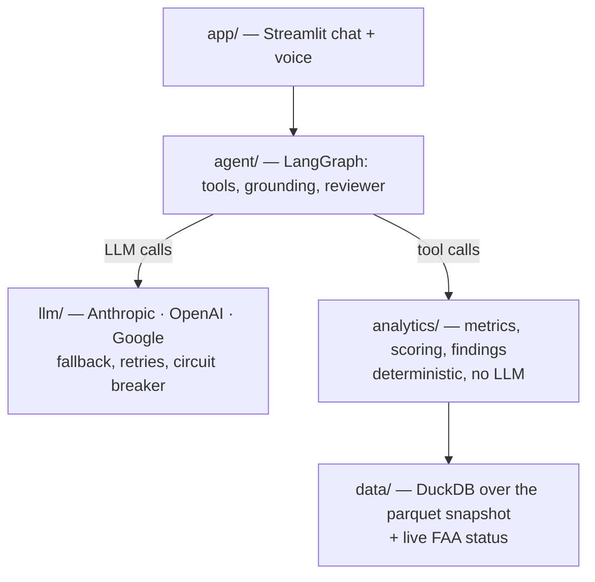
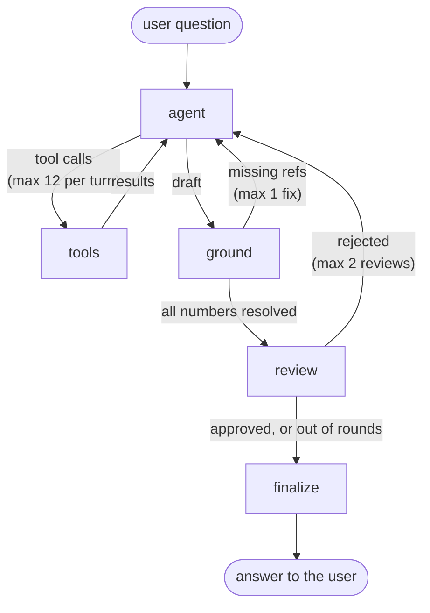
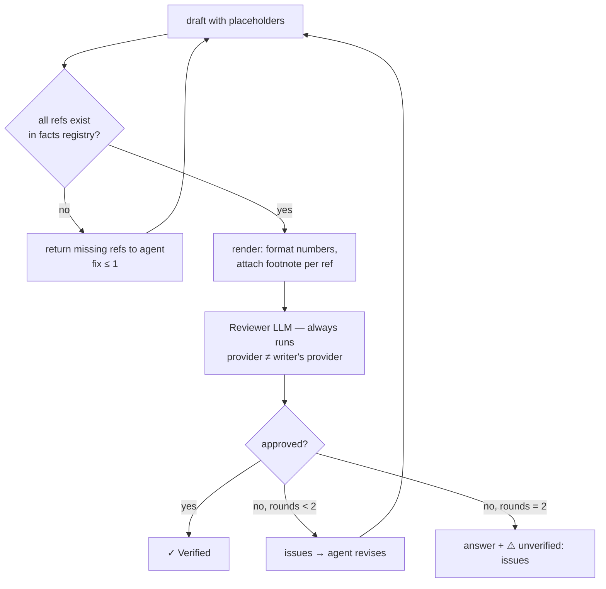

# Airport Investment Intelligence Agent: Design

**Live demo:** https://airport-investment-agent-2rnc9cgsamvrtnubz5rk9q.streamlit.app/

**Data:** BTS T-100 (2019-01 to 2026-07) and BTS On-Time Performance for the latest 12 months
(2025-08 to 2026-07), OurAirports for names and regions, and the live FAA NAS Status feed.
The exact periods are in `snapshot/manifest.json`.

## 1. What it does

An analyst asks a question in chat or by voice, for example "Which airports in New England are
strong candidates for terminal expansion?". The agent picks the analysis tools to run. Every
number in the answer is computed in code and cited to its source. A second AI, from a different
provider, checks the conclusions before the answer is shown.

**The core rule: the LLM orchestrates and explains, code computes and decides.**

## 2. Architecture

The architecture is a **layered monolith**: `app` → `agent` → `analytics` → `data`. Dependencies
point one way only. `analytics/` and `data/` never import the agent, the LLM layer or the UI, so
the scoring can run and be tested with no LLM at all. That is the structural proof that it is
deterministic. Adapters (one interface, several implementations) exist only in `llm/`, where there
really are several: Anthropic, OpenAI, Google, and a fake LLM in tests.

**The agent graph** (`agent/graph.py`). Every loop in it has a bound:

**Tools.** All tools are read-only and typed with Pydantic. Each one returns facts, structured
findings, assumptions and data coverage, not only numbers.

| Tool | Answers |
|---|---|
| `resolve_airports` | "New England", "LA", "Bay Area" → airport codes (built-in regions and metros; unknown regions use LLM-proposed states that code validates and states as an assumption) |
| `rank_airports` | Opportunity Score ranking with focus `overall` / `terminal` / `airside`, sensitivity, exclusions |
| `compare_airports` | Congestion side by side (taxi-out, taxi-in, NAS delay, delay rate) plus computed findings |
| `airport_profile` | One airport in full: KPIs, unmet demand (seats gap), delay causes, national rank, trend |
| `route_mix` | Long-haul share (≥ 2,400 mi), distance buckets, top destinations |
| `concentration_risk` | Airline shares, HHI and risk band |
| `live_status` | Current FAA delays and closures. Context only, never used in scoring |

Conversation memory is a LangGraph checkpointer on SQLite, so follow-ups ("and why is it first?")
see the earlier turns. Earlier turns are trimmed to a 12k-token budget.

## 3. Scoring methodology

**KPI: the Opportunity Score (0-100).** It measures how strongly demand presses on an airport's
capacity, and so where a renovation would unlock the most extra flights and passengers.

| Component | Weight | Metric | Why it matters |
|---|---|---|---|
| Demand | 0.35 | load factor (passengers / seats) | full planes are demand the airport could serve with more flights |
| Growth | 0.25 | passengers, last 12 months vs the 12 before | demand that is still rising |
| Terminal strain | 0.125 | average taxi-in minutes (waiting for a gate) | gates and terminal are the bottleneck |
| Airside strain | 0.125 | mean of the taxi-out and NAS-delay-minutes-per-flight percentiles | runway and airspace queues |
| Scale | 0.15 | log(passengers) | the same percentage gain is worth more at a big airport |

- **Peer group:** US airports with at least 500,000 passengers in the last 12 months. Below that,
  a tiny airport with three full flights would jump to the top.
- **Percentiles, not min-max.** Each metric becomes a percentile rank among the peers, so units do
  not matter and a giant like ATL does not compress everyone else.
- **Score** = the weighted sum of the percentiles × 100, with the weights normalized to sum to 1.
  If a component is missing (an airport with no On-Time data), its weight is dropped and the
  others are renormalized for that airport. The confidence label shows the gap.
- **National score, local rank.** Percentiles are always national, so a score stays stable between
  questions. The rank (#1, #2) is within the airports the question asked about.
- **Why a combined score, not load factor alone:** a full plane at an uncongested airport is the
  airlines' problem, and building more terminal will not help. Only "full and congested" points at
  the airport itself.
- **Bottleneck classification:** a strain percentile of at least 0.66 counts as high. Terminal
  high only gives Terminal-constrained, airside high only gives Airside-constrained, both high
  gives Both, and neither gives Unconstrained. With no On-Time data the class is Unknown. The
  terminal focus keeps Terminal-constrained and Both, because if the runways are the binding
  limit, a new terminal will not bring more aircraft.
- **Unmet demand (seats gap):** max(0, passengers / 0.80 − seats). This is the number of seats
  needed to bring the load factor down to a healthy 80%. It is shown together with the
  delay-cause mix that explains it.
- **Confidence:** high needs 12 months of T-100 and On-Time coverage of at least 50%. Medium needs
  coverage of at least 20%. Anything else is low.
- **Sensitivity:** each weight is scaled by 0.9 and by 1.1 in turn, giving 10 scenarios. An
  airport whose rank never moves is "stable". Otherwise the answer says "#2 to #4 depending on the
  weights".
- **Findings are computed in code.** A difference under 10% is "similar", one over 50% is
  "large", and opposite signs count as large. The HHI bands are under 1,500, 1,500 to 2,500, and
  over 2,500 (the DOJ bands). The LLM explains these conclusions but never decides them.
- **The analyst can change the weights** with the sidebar sliders. The code applies the sliders
  to `rank_airports` even if the model passed other weights.

All weights and thresholds live in `airport_agent/config.py`.

## 4. Where and how AI is used

| Task | Who does it |
|---|---|
| Understanding the question, asking for clarification when two readings give different answers | LLM (agent) |
| Choosing tools and their arguments | LLM (agent); arguments are validated in code like user input |
| Every metric, score, rank, classification and comparison finding | **code** |
| Every number in the answer | **code**: the model writes `{{SFO.load_factor}}` and the renderer fills in the value and a footnote |
| Explaining the findings in plain language, follow-up suggestions | LLM (agent) |
| Checking conclusions against the findings, stated assumptions, answering the question | LLM (reviewer, a different provider) |
| Speech to text, and the spoken answer | OpenAI audio models, Gemini as fallback |

The defense is layered, because no single layer is enough on its own:

1. Conclusions come from code (findings).
2. Numbers cannot be invented or attached to the wrong airport (placeholders).
3. The reviewer checks what is left: is every conclusion supported, are the period and
   assumptions stated, is the question answered. It blocks only on six named rules, and every
   blocking issue must quote the answer. Style comments become non-blocking notes.
4. Every retry is bounded, then the answer is shown with an honest ⚠️ and the reasons.
5. Evals measure what still gets through.

**Models.** The agent is Anthropic Claude Haiku with OpenAI gpt-5.4-mini as fallback. The
reviewer chain is Anthropic → Google Gemini Flash → OpenAI, always skipping the writer's
provider. Errors are handled by HTTP status in `llm/resilience.py`:

- 400 fails fast, because it is our bug and a fallback would hide it.
- 401, 403 and 404 fall back at once.
- 429 waits for a short Retry-After (up to 5 s) or falls back.
- 5xx and timeouts retry twice with backoff, then fall back.
- A circuit breaker skips a provider that just failed, for 60 s.

## 5. Key tradeoffs

| Decision | Chosen | Alternative | Why |
|---|---|---|---|
| Data access | committed snapshot (ETL) | live API calls per question | BTS On-Time comes as large monthly files, not a query API, and ranking a region would take dozens of calls. A snapshot is fast, reproducible and testable. Cost: data is as fresh as the last ingest. Live FAA status is the one live tool. |
| Who computes | typed tools | text-to-SQL | the LLM would compute the numbers, so they would not be deterministic or testable. A small set of tested tools beats unlimited flexibility that cannot be verified. |
| Numbers | placeholders filled by code | the LLM writes numbers | removes invented and misattributed numbers by construction. Cost: a stricter prompt and one bounded fix loop. |
| Verification | reviewer LLM from another provider | none, or the same model | a model checking itself tends to approve. Cost: about one extra LLM call per answer. |
| Scoring | percentiles and fixed, visible weights | an ML model | no labeled "profitable renovation" data exists. A transparent formula can be explained, tested and changed with the sliders. |
| Proxies | load factor, taxi times, NAS delay | gate counts, terminal area | there is no public, consistent national source of physical capacity. This is stated as an assumption in every answer. |
| Ambiguity | ask a clarifying question | assume and state it | a wrong guess means wrong tool calls and a wrong answer. The agent asks only when two readings give different answers ("How busy is LA?"), and answers when the words settle it ("LA airport" = LAX). |
| Voice | STT → the same text pipeline → TTS | realtime speech-to-speech | the same tools, grounding and reviewer apply to spoken answers. For an analyst, correct numbers matter more than latency. In a customer-service voice agent, where turn-taking is the product, I would weigh realtime differently. |
| Providers | three providers with fallback | one provider | an outage of one vendor does not stop the product, and the reviewer needs a second vendor anyway. |
| UI | Streamlit | React + FastAPI | time-boxed to one day. The agent has no UI dependency, so a React front end would replace only the thin `app/` layer. |

## 6. Security

The main defense is a small blast radius, not filtering prompt injection, which cannot be done
reliably.

- All tools are read-only. There is no code execution, no URL fetching and no writes.
- Tool arguments from the LLM are untrusted input: Pydantic schemas, airport codes checked
  against the database, and parameterized SQL only.
- User input is length-capped (2,000 characters) and cleaned of control and zero-width
  characters.
- Free text from the FAA feed never reaches the LLM (indirect injection). Only whitelisted
  fields do.
- Every text that reaches the user goes through an output filter that removes any link or image
  outside an allowlist. Why: a prompt injection could make the model write
  `` with chat content in the URL. The browser loads an image
  automatically, so the data would leak without a single click (markdown exfiltration). The only
  links an answer needs are the source citations, so everything else is removed. The filter fails
  safe: anything it cannot parse is removed too.
- API keys come only from environment variables or Streamlit secrets.

## 7. Assumptions, scope, limitations

- **Scope:** US commercial airports. The KPI measures investment opportunity, not financial
  return. Construction costs, fees and concession revenue are out of scope.
- **On-Time** covers domestic flights of reporting carriers only. Anchorage's international and
  cargo traffic is missing there, and the agent says so. The international share comes from
  T-100.
- **Airside strain** mixes runway capacity with airspace and ATC limits, which building at the
  airport cannot fix. NAS delay also includes ordinary weather (fog at SFO).
- **Taxi-in is a noisy proxy** for gate shortage, since taxi times also depend on airport layout.
- **The reviewer is an LLM** and can miss errors or reject good answers. The evals measure how
  often. When it is unavailable (for example under rate limits), the answer is shown as
  unverified instead of failing.
- **Chat history** lives in SQLite, so on a cloud host with ephemeral disk it resets on redeploy.
- **Voice:** the fallback TTS (Gemini) is a different voice from the primary, chosen on purpose
  over a silent agent. Silence detection uses a fixed loudness threshold that may need tuning per
  microphone.

## 8. Testing and evals

- **228 offline tests** run in CI (GitHub Actions, with ruff). They use a synthetic snapshot and
  a scripted fake LLM. Integration tests drive the real graph through a tool loop, a grounding
  fix, a reviewer rejection, a provider fallback on 503, and all providers down.
- **27 eval cases** (`evals/cases.yaml`) run the real graph on real LLMs. They cover the 4 brief
  questions, follow-ups, ambiguity, clarifying questions, investment risk, out-of-scope requests, red-team attacks
  and voice answers. The checks are code, not an LLM judge: which tools were called, expected
  airports in the top 3, cited fact keys, refusals, forbidden strings, grounding. Every report
  records the prompt hash and the git SHA, so a change in a metric can be traced to a prompt
  change or a code change. Runs are also LangSmith experiments on one dataset, so two prompt
  versions can be compared case by case.

| Run | Cases | Passed | Verified by reviewer |
|---|---|---|---|
| OpenAI agent (latest full run, before the risk case) | 26 | 24 | 24 |
| Anthropic agent (latest full run, before the voice cases were added) | 23 | 23 | 17 |

Most unverified Anthropic answers were refusals and declines, where the reviewer (then Gemini)
asked for more than a refusal needs. That is reviewer variance, not a wrong answer. The two
OpenAI failures are clarification cases (`ambiguity_new_york`, `clarify_compare_one`).
gpt-5.4-mini tends to answer with a stated assumption where Claude Haiku asks first. This is one
reason Anthropic is the primary agent.

Several bugs were found only by live runs and the reviewer, not by unit tests. Two examples: two
tools wrote the same fact key with different meanings, and a ratio was computed between a growth
and a decline. That is the argument for keeping the evals and the reviewer next to the unit tests.

## 9. What I would do next

- Physical capacity data (gates, runways) from FAA airport records, to replace the taxi-time
  proxies.
- A financial layer, to move from opportunity to return: the cost of a project (for example the
  cost per new gate) against the revenue it brings (the per-passenger facility charge, landing
  fees, concessions).
- A scheduled ingest with data-drift checks.
- Postgres for the checkpointer, so chat history survives redeploys.
- Per-user auth and rate limits.
- A React + FastAPI front end, and streaming TTS for lower voice latency.
