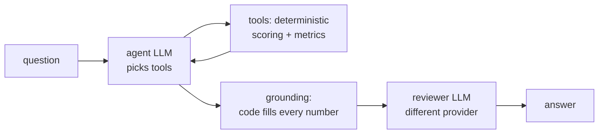

# Airport Investment Intelligence Agent

Chat (or talk) with an agent that ranks and explains US airport renovation opportunities from
public BTS and FAA data. Every number in an answer is computed in code and cited, and a second AI
from a different provider checks the conclusions before the answer is shown.

**Live demo:** https://airport-investment-agent-2rnc9cgsamvrtnubz5rk9q.streamlit.app/ (it may
take a minute to wake up if nobody has used it recently).

**Design document:** [DESIGN.md](DESIGN.md): scoring methodology, key tradeoffs, where and how AI
is used.

Try:
- Which airports in New England are strong candidates for terminal expansion?
- Compare LA and Santa Ana airport congestion levels.
- What is the percentage of long haul flights out of Anchorage airport?
- What is the unmet flight demand in SFO airport and why?

Then ask a follow-up, such as "Why is it first?" or "Compare it with Hartford". The agent
remembers the conversation.

## What you get in an answer

- **TL;DR** first, then the full explanation. Every number has a footnote linking to its dataset
  and period.
- **A verification badge:** "✓ Verified by a second AI" when a model from a different provider
  approved the conclusions. Otherwise "⚠️ Not verified", with the reviewer's reasons.
- **A chart** of the airports in the answer, when it compares or ranks airports.
- **Expanders:**
  - Sources
  - Data, with a CSV download
  - How I got this (the tools called)
  - Assumptions & coverage
- **Follow-up buttons** with natural next questions.
- **Score weights** in the sidebar. Move a slider and the next ranking uses your weights.
- **Voice:** press the mic in the chat box and ask. Voice questions get a spoken answer, and the
  written answer stays one click away.
- **Clarifying questions:** when a question has two readings that give different answers ("How
  busy is LA?"), the agent asks instead of guessing.

## How it works



1. The agent (Claude Haiku, with GPT as fallback) reads the question and chooses tools such as
   `resolve_airports`, `rank_airports`, `compare_airports` and `airport_profile`.
2. The tools compute everything in plain Python over a DuckDB snapshot. That covers the
   **Opportunity Score (0-100)**, a weighted mix of load factor, growth, terminal strain, airside
   strain and scale, each as a percentile among US airports with at least 500k passengers.
3. The model writes the answer with placeholders such as `{{SFO.load_factor}}`, and code
   replaces them with the real value and a citation. The model never types a data number.
4. A reviewer model from a different provider checks that every conclusion is supported. If it
   rejects the answer, the agent revises it, up to two reviews.

The full scoring methodology, tradeoffs and limitations are in [DESIGN.md](DESIGN.md).

## Data sources

| Source | Used for |
|---|---|
| [BTS T-100 Segment Summary](https://data.bts.gov/Aviation/AFF-T100-Segment-Summary-By-Origin-Airport/r495-tyji) | passengers, seats, load factor, growth, international share |
| [BTS Airline On-Time Performance](https://www.transtats.bts.gov/Fields.asp?gnoyr_VQ=FGJ) | taxi-out, taxi-in, delay causes, routes and distances |
| [OurAirports](https://ourairports.com/data/) | names, states, regions |
| [FAA NAS Status](https://nasstatus.faa.gov/) | live delays and closures (context only, not scored) |

The latest snapshot covers 2025-08 to 2026-07. The exact periods are in
`snapshot/manifest.json`.

## Run locally

Requires Python 3.13 and [uv](https://docs.astral.sh/uv/).

```bash
git clone https://github.com/lioka0099/airport-investment-agent.git
cd airport-investment-agent
uv sync
cp .env.example .env   # then add your keys (see below)
uv run --env-file .env streamlit run app/streamlit_app.py
```

Keys: `ANTHROPIC_API_KEY` (agent), `OPENAI_API_KEY` (fallback agent and voice), and
`GOOGLE_API_KEY` (reviewer and voice fallback). Each one is optional on its own. A provider with no
key is skipped, but at least one agent key is needed. The reviewer always uses a different
provider from the one that wrote the answer, so at least two keys give a verified answer.
LangSmith tracing is optional (`LANGSMITH_*`).

## Tests and evals

```bash
uv run pytest -q          # offline: synthetic snapshot and a scripted fake LLM, no keys needed
uv run ruff check .
```

The evals run the real graph on real LLMs, so they cost money and are not part of CI:

```bash
uv run --env-file .env python -m evals.run_evals --provider anthropic            # all cases
uv run --env-file .env python -m evals.run_evals --provider openai --only brief_sfo_unmet_demand
uv run --env-file .env python -m evals.run_evals --provider openai --langsmith   # LangSmith experiment
```

Reports are written to `evals/reports/`. Case ids are in `evals/cases.yaml`.

## Refresh the data

The app reads a committed snapshot (`snapshot/*.parquet` and `manifest.json`), so it needs no
downloads at startup. To rebuild it from BTS and OurAirports (slow, about 12 monthly On-Time
files):

```bash
uv run python -m airport_agent.data.ingest
```

## Configuration

Every tunable lives in `airport_agent/config.py`:
- Score weights and the 500k-passenger peer threshold.
- The strain threshold, the 80% load-factor target and the 2,400-mile long-haul cutoff.
- The model chains for the agent, the reviewer and voice.
- The loop limits (tool budget, review rounds) and the timeouts.

## Troubleshooting

| You see | Why | Fix |
|---|---|---|
| "No API key for any agent provider" | no Anthropic or OpenAI key in `.env` | add one and restart |
| "⚠️ Not verified: The reviewer was unavailable" on every answer | only one provider has a key, or it is rate-limited | add a second provider's key |
| "Couldn't hear that" after recording | the recording was silent (no API call is made) | speak closer to the mic; the threshold is `SILENCE_LEVEL` in `app/voice.py` |
| Changes in `airport_agent/` don't show up while the app runs | Streamlit only watches `app/` | restart, or add `--server.folderWatchList "$PWD/airport_agent"` |

## Project layout

```
airport_agent/
  config.py   every weight, threshold, model and limit in one place
  data/       ingest from BTS T-100, BTS On-Time, OurAirports; DuckDB store; live FAA client
  analytics/  metrics, scoring, findings: deterministic, no LLM
  agent/      tools, prompts, grounding, reviewer, the LangGraph graph
  llm/        provider router, retries, fallback, circuit breaker
  security/   input cleaning and output filtering
app/          Streamlit page, answer view, voice (STT and TTS)
evals/        eval cases and runner
tests/        unit and integration tests
snapshot/     committed parquet data and manifest
```
